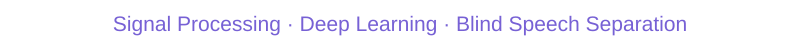
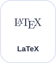
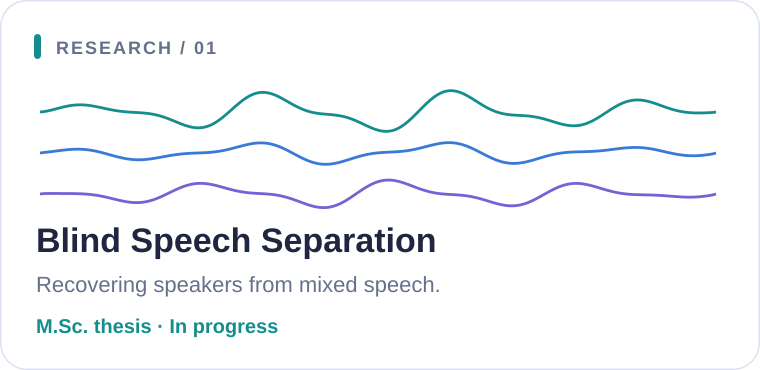
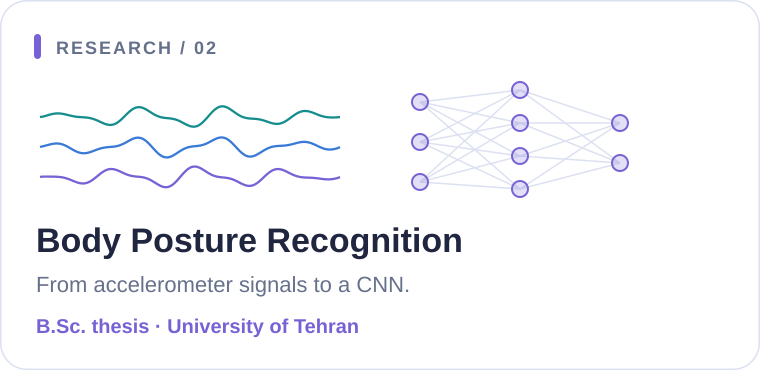

<picture>
  <source media="(prefers-color-scheme: dark)" srcset="./assets/header-dark.svg">
  <source media="(prefers-color-scheme: light)" srcset="./assets/header-light.svg">
  
</picture>

<picture>
  <source media="(prefers-color-scheme: dark)" srcset="./assets/typing-dark.svg">
  <source media="(prefers-color-scheme: light)" srcset="./assets/typing-light.svg">
  
</picture>

<a href="https://www.linkedin.com/in/arman-majidi/">
<picture>
  <source media="(prefers-color-scheme: dark)" srcset="./assets/linkedin-dark.svg">
  <source media="(prefers-color-scheme: light)" srcset="./assets/linkedin-light.svg">
  
</picture>
</a>
<a href="mailto:arman.majidi.2003@gmail.com">
<picture>
  <source media="(prefers-color-scheme: dark)" srcset="./assets/email-dark.svg">
  <source media="(prefers-color-scheme: light)" srcset="./assets/email-light.svg">
  
</picture>
</a>
<a href="https://github.com/arman-majidi?tab=repositories">
<picture>
  <source media="(prefers-color-scheme: dark)" srcset="./assets/github-dark.svg">
  <source media="(prefers-color-scheme: light)" srcset="./assets/github-light.svg">
  
</picture>
</a>

## 🧠 About me

I'm an **M.Sc. student in Electrical Engineering — Telecommunications (Systems)** at **Sharif University of Technology**, working at the intersection of **signal processing and machine learning**.

- 🔬 My current research focuses on **blind speech separation**, supervised by **Dr. Massoud Babaie-Zadeh**.
- 🎓 I hold a **B.Sc. in Electrical Engineering** from the **University of Tehran**.
- 💻 I work with **Python and MATLAB** for signal processing and deep learning.

## 🛠️ Languages & tools

<picture>
  <source media="(prefers-color-scheme: dark)" srcset="./assets/python-dark.svg">
  <source media="(prefers-color-scheme: light)" srcset="./assets/python-light.svg">
  
</picture>
<picture>
  <source media="(prefers-color-scheme: dark)" srcset="./assets/matlab-dark.svg">
  <source media="(prefers-color-scheme: light)" srcset="./assets/matlab-light.svg">
  
</picture>
<picture>
  <source media="(prefers-color-scheme: dark)" srcset="./assets/pytorch-dark.svg">
  <source media="(prefers-color-scheme: light)" srcset="./assets/pytorch-light.svg">
  
</picture>
<picture>
  <source media="(prefers-color-scheme: dark)" srcset="./assets/tensorflow-dark.svg">
  <source media="(prefers-color-scheme: light)" srcset="./assets/tensorflow-light.svg">
  
</picture>
<picture>
  <source media="(prefers-color-scheme: dark)" srcset="./assets/keras-dark.svg">
  <source media="(prefers-color-scheme: light)" srcset="./assets/keras-light.svg">
  
</picture>
<picture>
  <source media="(prefers-color-scheme: dark)" srcset="./assets/latex-dark.svg">
  <source media="(prefers-color-scheme: light)" srcset="./assets/latex-light.svg">
  
</picture>

  <strong>Audio &amp; graph processing</strong> 
  <code>librosa</code> &nbsp; <code>GSPBox</code>

## 🔬 Research

<picture>
  <source media="(prefers-color-scheme: dark)" srcset="./assets/speech-dark.svg">
  <source media="(prefers-color-scheme: light)" srcset="./assets/speech-light.svg">
  
</picture>
<picture>
  <source media="(prefers-color-scheme: dark)" srcset="./assets/posture-dark.svg">
  <source media="(prefers-color-scheme: light)" srcset="./assets/posture-light.svg">
  
</picture>

My master's research is supervised by **Dr. Massoud Babaie-Zadeh** at Sharif University of Technology. My bachelor's thesis was supervised by **Dr. Saeed Akhavan** at the University of Tehran.

## 🎓 Background

- **2025–present** · M.Sc., Electrical Engineering — **Sharif University of Technology**
- **2021–2025** · B.Sc., Electrical Engineering — **University of Tehran**
- **September 2024–June 2025** · Signal Processing Engineer — **Hekimed**
- **September 2023–February 2025** · Teaching Assistant — communication systems, signals and systems, engineering mathematics, and probability and statistics.

<strong>📚 Coursework &amp; continued learning</strong>

**Academic coursework:** Blind Source Separation, Adaptive Filters, Estimation Theory, Neural Networks and Deep Learning, Graph Signal Processing, Foundations of Computer Vision, and Information Theory and Learning.

**Completed specializations:** Machine Learning (Stanford University), Deep Learning (DeepLearning.AI), and Digital Signal Processing (EPFL).

**Currently learning:** PyTorch for Deep Learning and Generative Adversarial Networks (DeepLearning.AI).

---

  Interested in signal processing or machine learning? 
  <a href="mailto:arman.majidi.2003@gmail.com"><strong>Let's connect.</strong></a>

