<picture>
  <source media="(prefers-color-scheme: dark)" srcset="./assets/header-dark.svg">
  
</picture>

  <a href="https://arman-majidi.github.io/">Website</a> &nbsp;·&nbsp;
  <a href="https://arman-majidi.github.io/assets/Arman_Majidi_CV.pdf">CV</a> &nbsp;·&nbsp;
  <a href="mailto:arman.majidi.2003@gmail.com">Email</a> &nbsp;·&nbsp;
  <a href="https://www.linkedin.com/in/arman-majidi/">LinkedIn</a> &nbsp;·&nbsp;
  <a href="https://orcid.org/0009-0001-6795-5552">ORCID</a>

## Hi, I'm Arman.

I'm an M.Sc. student at **Sharif University of Technology**, working on [blind speech separation](https://arman-majidi.github.io/#research) with Dr. Massoud Babaie-Zadeh.

I study how to recover individual voices when several people speak at once. More broadly, I'm interested in statistical signal processing and in what learning methods can tell us about a signal.

Before Sharif, I studied electrical engineering at the **University of Tehran**. My undergraduate thesis used accelerometer data and a CNN to recognize body postures, under Dr. Saeed Akhavan.

I'm applying for PhD positions in speech, audio and statistical signal processing.

## Research

### Blind speech separation

*M.Sc. thesis, in progress · Sharif University of Technology*

A microphone records everything at once. My research asks how we can recover the individual speakers from overlapping recordings, without knowing the mixing process in advance.

  <a href="https://arman-majidi.github.io/#research">
    <picture>
      <source media="(prefers-color-scheme: dark)" srcset="./assets/speech-dark.svg">
      
    </picture>
  </a>

### Recognizing body posture from sensor data

*B.Sc. thesis, 2025 · University of Tehran*

I built a CNN pipeline that classifies body postures from three-axis accelerometer recordings.

  <a href="https://arman-majidi.github.io/#research">
    <picture>
      <source media="(prefers-color-scheme: dark)" srcset="./assets/posture-dark.svg">
      
    </picture>
  </a>

Both figures are illustrations built from synthetic signals, not experimental data or results. The interactive versions are on the [website](https://arman-majidi.github.io/#research).

## Education and experience

**Education**

- **M.Sc., Electrical Engineering** (Telecommunications, Systems) · Sharif University of Technology · 2025 – present
- **B.Sc., Electrical Engineering** (Telecommunications) · University of Tehran · 2021 – 2025

**Experience**

- **Teaching assistant** · Sharif University of Technology and University of Tehran · Sep 2023 – present 
  Adaptive Filters, Signals and Systems, Communication Systems, Engineering Mathematics, Probability and Statistics
- **Signal processing engineer** (part-time) · Hekimed · Sep 2024 – Jun 2025

Coursework, certifications and the full CV are on the [website](https://arman-majidi.github.io/).

## Tools

  <picture>
    <source media="(prefers-color-scheme: dark)" srcset="./assets/tools-dark.svg">
    
  </picture>

  Audio and graph signal libraries: <code>librosa</code> · <code>GSPBox</code>

---

  If you work on source separation, speech or signal processing, I'd be happy to hear from you: <a href="mailto:arman.majidi.2003@gmail.com">arman.majidi.2003@gmail.com</a>

