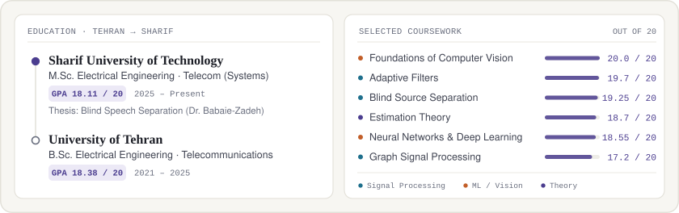

<picture>
  <source media="(prefers-color-scheme: dark)" srcset="./assets/header-dark.svg">
  
</picture>

  <a href="https://arman-majidi.github.io/"><strong>Interactive Website</strong></a> &nbsp;·&nbsp;
  <a href="https://arman-majidi.github.io/assets/Arman_Majidi_CV.pdf">CV (PDF)</a> &nbsp;·&nbsp;
  <a href="mailto:arman.majidi.2003@gmail.com">Email</a> &nbsp;·&nbsp;
  <a href="https://www.linkedin.com/in/arman-majidi/">LinkedIn</a> &nbsp;·&nbsp;
  <a href="https://orcid.org/0009-0001-6795-5552">ORCID</a>

## Hi, I'm Arman.

I'm an M.Sc. student in Electrical Engineering at **Sharif University of Technology**, working on [blind speech separation](https://arman-majidi.github.io/#research) with Dr. Massoud Babaie-Zadeh.

I study how to recover individual voices when several people speak at once. More broadly, I'm interested in statistical signal processing and in what learning methods can reveal about a signal. Before Sharif, I completed my B.Sc. in Electrical Engineering at the **University of Tehran**, where my undergraduate thesis used three-axis accelerometer data and a CNN to recognize body postures under the supervision of Dr. Saeed Akhavan.

  <strong>Research interests:</strong>&nbsp;
  <code>Blind speech separation</code>&nbsp;
  <code>Speech &amp; audio</code>&nbsp;
  <code>Adaptive filtering</code>&nbsp;
  <code>Estimation theory</code>&nbsp;
  <code>Deep learning</code>&nbsp;
  <code>Graph signal processing</code>

## Research

### Blind speech separation

*M.Sc. thesis, in progress · Sharif University of Technology · Supervised by Dr. Massoud Babaie-Zadeh*

A microphone records everything at once. My research asks how we can recover individual speakers from overlapping recordings without knowing the mixing process in advance.

  <a href="https://arman-majidi.github.io/#research">
    <picture>
      <source media="(prefers-color-scheme: dark)" srcset="./assets/speech-dark.svg">
      
    </picture>
  </a>

### Recognizing body posture from sensor data

*B.Sc. thesis, 2025 · University of Tehran · Supervised by Dr. Saeed Akhavan*

I built a 1D-CNN pipeline to classify body postures from three-axis accelerometer recordings — from raw sensor streams and sliding windows to posture prediction.

  <a href="https://arman-majidi.github.io/#research">
    <picture>
      <source media="(prefers-color-scheme: dark)" srcset="./assets/posture-dark.svg">
      
    </picture>
  </a>

Both figures are illustrative sketches built from synthetic signals, not experimental data or thesis results. Click either figure to explore the live interactive labs (real-time speech audio, STFT spectrograms, and an interactive 3D accelerometer) on my <a href="https://arman-majidi.github.io/#research">website</a>.

## Academic background &amp; experience

  <a href="https://arman-majidi.github.io/#education">
    <picture>
      <source media="(prefers-color-scheme: dark)" srcset="./assets/academic-dark.svg">
      
    </picture>
  </a>

- **Signal Processing Engineer** *(part-time)* · **Hekimed** · Sep 2024 – Jun 2025 
  Signal processing and sensor data analysis alongside graduate and undergraduate studies.
- **Teaching Assistant** · **Sharif University of Technology &amp; University of Tehran** · Sep 2023 – Present

  
Courses I have assisted (5)

   
  <ul>
    <li><strong>Adaptive Filters</strong> — Sharif University of Technology · Dr. Massoud Babaie-Zadeh (Fall 2026)</li>
    <li><strong>Communication Systems Introduction</strong> — University of Tehran · Dr. Maryam Sabbaghian &amp; Dr. Ali Olfat (Fall 2024)</li>
    <li><strong>Signals and Systems</strong> — University of Tehran · Dr. Saeed Akhavan (2023–2024) &amp; Dr. Mohammad Ali Akhaee (Fall 2024)</li>
    <li><strong>Engineering Mathematics</strong> — University of Tehran · Dr. Ali Haghi (Fall 2023) &amp; Dr. Mehdi Tale Masouleh (2024–2025)</li>
    <li><strong>Engineering Probability and Statistics</strong> — University of Tehran · Dr. Ali Haghi (Fall 2023) &amp; Dr. Amir Masoud Rabiei (Fall 2024)</li>
  </ul>

## Tools &amp; libraries

  <picture>
    <source media="(prefers-color-scheme: dark)" srcset="./assets/tools-dark.svg">
    
  </picture>

  <picture>
    <source media="(prefers-color-scheme: dark)" srcset="./assets/divider-dark.svg">
    
  </picture>

  If you work on source separation, speech, or statistical signal processing, I'd be happy to hear from you: <a href="mailto:arman.majidi.2003@gmail.com">arman.majidi.2003@gmail.com</a> · Full CV &amp; interactive labs at <a href="https://arman-majidi.github.io/">arman-majidi.github.io</a>

