<picture>
  <source media="(prefers-color-scheme: dark)" srcset="./assets/header-dark.svg">
  <source media="(prefers-color-scheme: light)" srcset="./assets/header-light.svg">
  
</picture>

  <strong>M.Sc. Student in Electrical Engineering · Telecommunications (Systems)</strong> 
  Sharif University of Technology · Tehran, Iran

  
  
  

## Hi, I'm Arman.

I work at the intersection of **signal processing and machine learning**, with a research focus on **blind speech separation**. My background combines telecommunications, deep learning, and hands-on signal processing in Python and MATLAB.

## Research

**Blind Speech Separation** · M.Sc. thesis, in progress  
Separating individual speakers from mixed speech recordings.  
Supervised by **Dr. Massoud Babaie-Zadeh** at Sharif University of Technology.

**Body Posture Recognition** · B.Sc. thesis  
Body posture recognition using accelerometer data and a convolutional neural network.  
Supervised by **Dr. Saeed Akhavan** at the University of Tehran.

## Tools I work with

  
  
  

  
  
  
  
  

## Background

- **M.Sc., Electrical Engineering** — Sharif University of Technology · 2025–present
- **B.Sc., Electrical Engineering** — University of Tehran · 2021–2025
- **Signal Processing Engineer** — Hekimed · September 2024–June 2025
- **Teaching Assistant** — September 2023–February 2025; communication systems, signals and systems, engineering mathematics, and probability and statistics.

<strong>Coursework &amp; continued learning</strong>

**Academic coursework:** Blind Source Separation, Adaptive Filters, Estimation Theory, Neural Networks and Deep Learning, Graph Signal Processing, Foundations of Computer Vision, and Information Theory and Learning.

**Completed specializations:** Machine Learning (Stanford University), Deep Learning (DeepLearning.AI), and Digital Signal Processing (EPFL).

**Currently learning:** PyTorch for Deep Learning and Generative Adversarial Networks (DeepLearning.AI).

---

Interested in signal processing or machine learning? [Let's connect.](mailto:arman.majidi.2003@gmail.com)
